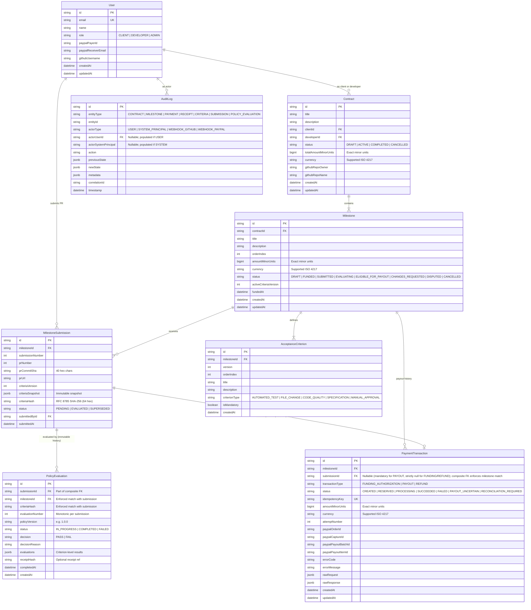

# VeriRelease — Milestone 2 Technical Design Document

**Document Title:** Domain Model, State Machine & Append-Only Audit Foundation  
**Version:** 2.8.0 — Architecture Review Revision 9  
**Status:** DRAFT (Version 2.8.0) — Documentation Clarification  
**Target Architecture:** Modular Clean Architecture, Next.js 15, TypeScript 5 (Strict), PostgreSQL 16, Prisma ORM, Vitest  

---

## 1. Executive Summary & Architectural Boundaries

### 1.1 Purpose
Milestone 2 establishes the core domain foundation of VeriRelease:
1. **Domain Model & Entities:** Strongly typed data models representing contracts, milestones, versioned acceptance criteria, immutable submission snapshots, persisted deterministic policy evaluations, decoupled payment transactions, and audit records.
2. **Exact Monetary Representation:** Integer `BIGINT` minor units (e.g. cents) paired with a versioned, maintained ISO 4217 currency dataset. Zero JavaScript floating-point math across the entire lifecycle.
3. **Deterministic Milestone State Machine:** A pure verification state machine tracking milestone readiness up to policy approval (`ELIGIBLE_FOR_PAYOUT`), with revision handling via `CHANGES_REQUESTED`. Milestone verification states are strictly decoupled from payment execution states.
4. **Decoupled Payment Transaction Lifecycle:** An independent payment state machine supporting short database transactions, atomic attempt allocation, RFC 8785 canonical idempotency keys, and explicit failure/uncertainty handling (`PAYOUT_UNCERTAIN`, `RECONCILIATION_REQUIRED`), with zero external PayPal API calls in this milestone.
5. **Persisted Approval Verification:** Payout reservation verifies an authoritative, completed, persisted `PolicyEvaluation` record with a `PASS` decision matching the exact latest submission before creating a reservation.
6. **Append-Only Audit Foundation:** An immutable ledger protected by PostgreSQL role-based permissions (`NOLOGIN` owner vs `LOGIN` runtime) and database triggers, with explicit attribution to typed actors.
7. **Repository & Migration Foundation:** Clean repository interfaces with transactional boundary support and declarative Prisma schema migrations.

### 1.2 Core Architectural Principles & Boundaries
- **Core Principle:** AI evaluates evidence &bull; Deterministic logic authorizes payment &bull; PayPal executes payment.
- **Separation of Milestone and Payment State Machines:** 
  - `MilestoneStatus` reflects verification progress only. `ELIGIBLE_FOR_PAYOUT` represents deterministic policy approval of submitted evidence. It does **not** represent payment execution or completion.
  - Payment progress is tracked exclusively within `PaymentTransaction`.
- **AI Execution Boundary:** The AI model is strictly an evidence evaluator. It cannot initiate state transitions, modify database records, or access payment credentials.
- **Financial Boundary & Custody Disclaimer:** 
  - VeriRelease is an automated milestone verification and payment authorization coordinator. It is **never** an escrow provider, bank, or financial custodian.
  - VeriRelease **never holds, receives, stores, returns, or safeguards funds**.
  - `FUNDED` represents external confirmation that an agreed funding authorization or arrangement has been established with the payment provider.
  - Milestone cancellation means the responsible provider or party releases or cancels the relevant external authorization.
- **Milestone 2 Scope Boundary:** No real external network calls to PayPal or GitHub in Milestone 2. Payment operations are modeled via reservation, state management, and idempotency key mechanics.

---

## 2. Exact Monetary Representation & Authoritative ISO 4217 Currency Support

To prevent floating-point rounding errors and precision loss:
1. **Integer Minor Units:** All monetary values in contracts, milestones, and payment transactions are stored as integer `BIGINT` minor units (e.g., `$1,000.00 USD` is represented as `100000`).
2. **Authoritative Dataset Provenance & Versioning:**
   - **Authoritative Agency:** SIX Financial Information AG / Swiss Association for Standardisation (SNV), official ISO 4217 Maintenance Agency (Table A.1 Current Currency List).
   - **Effective Dataset Version:** `ISO-4217-MA-2024-01-01` *(project-maintained subset based on the ISO 4217 Maintenance Agency (SIX Financial Information AG / SNV). The exact source artifact version and publication date have not been independently verified; this dataset should be reviewed against the official ISO 4217 Maintenance Agency publication before production deployment.)*
   - **Application Version Constant:** `CURRENCY_DATASET_VERSION = "ISO-4217-MA-2024-01-01"`.
   - **Curated Active Subset:** VeriRelease supports an explicit subset of 18 high-volume currencies covering zero-, two-, and three-decimal formats:
     ```typescript
     export const CURRENCY_DATASET_VERSION = "ISO-4217-MA-2024-01-01" as const;

     export const SUPPORTED_CURRENCIES = [
       // Two-decimal currencies (1 major unit = 100 minor units)
       "USD", "EUR", "GBP", "CAD", "AUD", "CHF", "SGD", "HKD", "NZD", "SEK", "NOK", "DKK", "PLN",
       // Zero-decimal currencies (1 major unit = 1 minor unit)
       "JPY", "KRW",
       // Three-decimal currencies (1 major unit = 1000 minor units)
       "BHD", "KWD", "OMR"
     ] as const;

     export type SupportedCurrency = typeof SUPPORTED_CURRENCIES[number];

     export const ISO_4217_CURRENCY_EXPONENTS: Record<SupportedCurrency, number> = {
       USD: 2, EUR: 2, GBP: 2, CAD: 2, AUD: 2, CHF: 2,
       SGD: 2, HKD: 2, NZD: 2, SEK: 2, NOK: 2, DKK: 2, PLN: 2,
       JPY: 0, KRW: 0,
       BHD: 3, KWD: 3, OMR: 3,
     };
     ```
3. **Validation & Rejection:**
   - Any currency code outside `SUPPORTED_CURRENCIES` is rejected during contract creation and milestone drafting by Zod runtime schemas (`UnsupportedCurrencyError`) and by PostgreSQL `CHECK ("currency" IN (...))`.
4. **Dataset Review & Deployment Workflow:**
   - Changes to currency codes, exponents, or additions require formal software releases with versioned Prisma/SQL migrations updating database check constraints and TypeScript type definitions.
5. **Historical Immutability of Monetary Interpretations:**
   - Historical contracts, milestones, and payment transactions permanently record `currency` and `amountMinorUnits`. Even if an upstream currency code is redenominated or deprecated by ISO in future releases, existing database records preserve their exact historical code, minor units, and exponent interpretation.
6. **Zero Floating-Point Conversion:** 
   - No JavaScript `Number()`, `parseFloat()`, or division operations are permitted on monetary quantities.
   - All arithmetic uses native `BigInt` or arbitrary-precision integer representations.
   - In canonical JSON serialization and database storage, minor unit values are encoded as integer strings (e.g. `"100000"`).

---

## 3. Domain Model & PostgreSQL Schema

### 3.1 Entity Relationship Diagram



---

### 3.2 Acceptance Criteria Versioning & Immutable Snapshots

To guarantee that changing requirements later cannot alter the criteria baseline used to evaluate an earlier submission:

1. **Strictly Immutable Historical Criterion Versions:**
   - Historical rows in `AcceptanceCriterion` are **100% immutable**. The column `isDeprecated` has been completely eliminated to prevent in-place row mutation.
   - `Milestone.activeCriteriaVersion` explicitly identifies the current active version (starts at `1`).
   - Criteria amendments are **INSERT-ONLY**: When criteria are amended, `activeCriteriaVersion` increments to `N + 1`, and new rows are inserted with `version = N + 1`. Old version rows remain untouched.
   - **Database-Level Immutability Trigger:** Any attempt to `UPDATE` or `DELETE` rows in `AcceptanceCriterion` is blocked by database trigger `trg_criteria_immutable`.
2. **Serialization Under Milestone Row Lock:**
   - Both criteria amendments and PR submissions acquire a milestone row lock (`SELECT activeCriteriaVersion FROM "Milestone" WHERE id = $1 FOR UPDATE`).
   - This serializes criteria amendments against submissions, ensuring that every submission snapshot captures one consistent criteria version without race conditions.
3. **Immutable Submission Snapshot (`MilestoneSubmission`):**
   - When a developer submits work (`SUBMITTED`), a `MilestoneSubmission` record is generated.
   - It captures an **immutable JSONB snapshot** of all criteria matching `activeCriteriaVersion` at that exact timestamp:
     ```json
     [
       {
         "criterionId": "crit_123",
         "criterionType": "AUTOMATED_TEST",
         "description": "All vitest tests in tests/unit must pass cleanly",
         "isMandatory": true,
         "orderIndex": 1,
         "title": "Pass unit test suite"
       }
     ]
     ```
   - **RFC 8785 Canonical Hash:** The snapshot is normalized using **RFC 8785 (JSON Canonicalization Scheme - JCS)**. A SHA-256 digest (`criteriaHash`, 64 hex characters) is computed over the canonical UTF-8 bytes and permanently stored.
   - **Submission Immutability Trigger:** `MilestoneSubmission` records are strictly immutable; `UPDATE` and `DELETE` operations are prohibited by database trigger `trg_submission_immutable`.
   - Evaluations run strictly against the frozen snapshot attached to the submission.

---

### 3.3 Database Ownership, Privileges & Migration Security

Database privileges enforce strict separation of duties, ensuring the runtime application cannot disable triggers, replace trigger functions, alter tables, or modify append-only ledgers:

#### A. Role Definitions & Security Boundaries
1. **Migration Owner Role (`verirelease_owner_role`):**
   - Defined with `NOLOGIN`.
   - Explicitly owns the `public` schema, all domain tables, triggers, and trigger functions.
   - Does not possess superuser privileges, but has complete DDL control over the application schema.
2. **Migration Deployment Identity (`verirelease_deployer`):**
   - Defined with `LOGIN`.
   - Granted membership in `verirelease_owner_role` (`GRANT verirelease_owner_role TO verirelease_deployer;`).
   - During automated CI/CD migrations, logs in and executes `SET ROLE verirelease_owner_role;` to apply schema changes.
   - Credentials stored in isolated deployment secrets (`MIGRATION_DATABASE_URL`).
3. **Application Runtime Role (`verirelease_app_user`):**
   - Defined with `LOGIN` and `NOINHERIT`.
   - **Strictly NOT a member of `verirelease_owner_role`**.
   - Used exclusively by the application connection pool (`DATABASE_URL`).
   - Receives only minimal DML permissions needed for normal operations.
   - Cannot execute DDL (`CREATE`, `ALTER`, `DROP`), cannot alter schema ownership, cannot replace trigger functions, and cannot disable triggers (`ALTER TABLE ... DISABLE TRIGGER` requires table ownership or superuser).

#### B. Privilege Grants & Schema Revocations
```sql
-- 1. Create Migration Owner Role (NOLOGIN)
CREATE ROLE verirelease_owner_role NOLOGIN;

-- 2. Create Migration Deployment Role (LOGIN)
-- Credentials provisioned externally via CI/CD secret manager; no literal passwords in source.
CREATE ROLE verirelease_deployer WITH LOGIN;
GRANT verirelease_owner_role TO verirelease_deployer;

-- 3. Create Application Runtime Role (LOGIN, NOINHERIT)
-- Credentials provisioned externally via runtime environment secret manager; no literal passwords in source.
CREATE ROLE verirelease_app_user WITH LOGIN NOINHERIT;

-- 4. Secure Public Schema: Revoke default CREATE privileges from PUBLIC
REVOKE CREATE ON SCHEMA public FROM PUBLIC;
ALTER SCHEMA public OWNER TO verirelease_owner_role;

-- 5. Grant Runtime DML Permissions on Public Schema
GRANT USAGE ON SCHEMA public TO verirelease_app_user;
GRANT SELECT, INSERT, UPDATE ON ALL TABLES IN SCHEMA public TO verirelease_app_user;

-- 6. Restrict Immutable Tables: Runtime can INSERT and SELECT, but NEVER UPDATE, DELETE, or TRUNCATE
REVOKE UPDATE, DELETE, TRUNCATE ON "AuditLog" FROM verirelease_app_user;
REVOKE UPDATE, DELETE, TRUNCATE ON "MilestoneSubmission" FROM verirelease_app_user;
REVOKE UPDATE, DELETE, TRUNCATE ON "AcceptanceCriterion" FROM verirelease_app_user;
REVOKE UPDATE, DELETE, TRUNCATE ON "PolicyEvaluation" FROM verirelease_app_user;

-- 7. Configure Default Privileges for future tables created by owner role
ALTER DEFAULT PRIVILEGES FOR ROLE verirelease_owner_role IN SCHEMA public
  GRANT SELECT, INSERT, UPDATE ON TABLES TO verirelease_app_user;

ALTER DEFAULT PRIVILEGES FOR ROLE verirelease_owner_role IN SCHEMA public
  REVOKE ALL ON TABLES FROM PUBLIC;

ALTER DEFAULT PRIVILEGES FOR ROLE verirelease_owner_role IN SCHEMA public
  GRANT EXECUTE ON FUNCTIONS TO verirelease_app_user;

-- 8. Assign Explicit Table Ownership to verirelease_owner_role for All Domain Tables
-- (Note: Changing schema ownership does not automatically alter ownership of existing tables)
ALTER TABLE "User" OWNER TO verirelease_owner_role;
ALTER TABLE "Contract" OWNER TO verirelease_owner_role;
ALTER TABLE "Milestone" OWNER TO verirelease_owner_role;
ALTER TABLE "AcceptanceCriterion" OWNER TO verirelease_owner_role;
ALTER TABLE "MilestoneSubmission" OWNER TO verirelease_owner_role;
ALTER TABLE "PolicyEvaluation" OWNER TO verirelease_owner_role;
ALTER TABLE "PaymentTransaction" OWNER TO verirelease_owner_role;
ALTER TABLE "AuditLog" OWNER TO verirelease_owner_role;
```

---

### 3.4 PostgreSQL DDL & Constraints Specification

```sql
-- 1. Enums
CREATE TYPE "ContractStatus" AS ENUM ('DRAFT', 'ACTIVE', 'COMPLETED', 'CANCELLED');

-- Pure verification states. Payment states are excluded.
CREATE TYPE "MilestoneStatus" AS ENUM (
  'DRAFT',
  'FUNDED',
  'SUBMITTED',
  'EVALUATING',
  'ELIGIBLE_FOR_PAYOUT',
  'CHANGES_REQUESTED',
  'DISPUTED',
  'CANCELLED'
);

CREATE TYPE "CriterionType" AS ENUM (
  'AUTOMATED_TEST',
  'FILE_CHANGE',
  'CODE_QUALITY',
  'SPECIFICATION',
  'MANUAL_APPROVAL'
);

CREATE TYPE "SubmissionStatus" AS ENUM ('PENDING', 'EVALUATED', 'SUPERSEDED');

CREATE TYPE "PolicyStatus" AS ENUM ('IN_PROGRESS', 'COMPLETED', 'FAILED');

CREATE TYPE "PolicyDecision" AS ENUM ('PASS', 'FAIL');

CREATE TYPE "PaymentTxType" AS ENUM ('FUNDING_AUTHORIZATION', 'PAYOUT', 'REFUND');

CREATE TYPE "PaymentTxStatus" AS ENUM (
  'CREATED',
  'RESERVED',
  'PROCESSING',
  'SUCCEEDED',
  'FAILED',
  'PAYOUT_UNCERTAIN',
  'RECONCILIATION_REQUIRED'
);

CREATE TYPE "AuditEntityType" AS ENUM (
  'CONTRACT',
  'MILESTONE',
  'PAYMENT',
  'RECEIPT',
  'CRITERIA',
  'SUBMISSION',
  'POLICY_EVALUATION'
);

CREATE TYPE "AuditActorType" AS ENUM (
  'USER',
  'SYSTEM_PRINCIPAL',
  'WEBHOOK_GITHUB',
  'WEBHOOK_PAYPAL'
);

-- Supported Currency Check Expression
-- Enforces ISO 4217 subset maintained by VeriRelease (18 currencies)

-- 2. Users Table
CREATE TABLE "User" (
  "id" VARCHAR(36) PRIMARY KEY,
  "email" VARCHAR(255) NOT NULL UNIQUE,
  "name" VARCHAR(255) NOT NULL,
  "role" VARCHAR(20) NOT NULL,
  "paypalPayerId" VARCHAR(100),
  "paypalReceiverEmail" VARCHAR(255),
  "githubUsername" VARCHAR(100),
  "createdAt" TIMESTAMPTZ NOT NULL DEFAULT NOW(),
  "updatedAt" TIMESTAMPTZ NOT NULL DEFAULT NOW()
);

-- 3. Contracts Table
CREATE TABLE "Contract" (
  "id" VARCHAR(36) PRIMARY KEY,
  "title" VARCHAR(255) NOT NULL,
  "description" TEXT NOT NULL,
  "clientId" VARCHAR(36) NOT NULL REFERENCES "User"("id") ON DELETE RESTRICT,
  "developerId" VARCHAR(36) NOT NULL REFERENCES "User"("id") ON DELETE RESTRICT,
  "status" "ContractStatus" NOT NULL DEFAULT 'DRAFT',
  "totalAmountMinorUnits" BIGINT NOT NULL,
  "currency" VARCHAR(3) NOT NULL DEFAULT 'USD',
  "githubRepoOwner" VARCHAR(100) NOT NULL,
  "githubRepoName" VARCHAR(100) NOT NULL,
  "createdAt" TIMESTAMPTZ NOT NULL DEFAULT NOW(),
  "updatedAt" TIMESTAMPTZ NOT NULL DEFAULT NOW(),
  CONSTRAINT "chk_contract_actors" CHECK ("clientId" <> "developerId"),
  CONSTRAINT "chk_contract_positive_amount" CHECK ("totalAmountMinorUnits" > 0),
  CONSTRAINT "chk_contract_supported_currency" CHECK (
    "currency" IN ('USD', 'EUR', 'GBP', 'CAD', 'AUD', 'CHF', 'SGD', 'HKD', 'NZD', 'SEK', 'NOK', 'DKK', 'PLN', 'JPY', 'KRW', 'BHD', 'KWD', 'OMR')
  ),
  CONSTRAINT "uq_contract_id_currency" UNIQUE ("id", "currency")
);

CREATE INDEX "idx_contract_client" ON "Contract"("clientId");
CREATE INDEX "idx_contract_developer" ON "Contract"("developerId");

-- 4. Milestones Table
CREATE TABLE "Milestone" (
  "id" VARCHAR(36) PRIMARY KEY,
  "contractId" VARCHAR(36) NOT NULL,
  "title" VARCHAR(255) NOT NULL,
  "description" TEXT NOT NULL,
  "orderIndex" INTEGER NOT NULL,
  "amountMinorUnits" BIGINT NOT NULL,
  "currency" VARCHAR(3) NOT NULL DEFAULT 'USD',
  "status" "MilestoneStatus" NOT NULL DEFAULT 'DRAFT',
  "activeCriteriaVersion" INTEGER NOT NULL DEFAULT 1,
  "fundedAt" TIMESTAMPTZ,
  "createdAt" TIMESTAMPTZ NOT NULL DEFAULT NOW(),
  "updatedAt" TIMESTAMPTZ NOT NULL DEFAULT NOW(),
  -- Composite FK enforcing strict contract currency match
  CONSTRAINT "fk_milestone_contract_currency" 
    FOREIGN KEY ("contractId", "currency") 
    REFERENCES "Contract"("id", "currency") 
    ON DELETE RESTRICT,
  CONSTRAINT "uq_contract_milestone_order" UNIQUE ("contractId", "orderIndex"),
  CONSTRAINT "chk_milestone_positive_amount" CHECK ("amountMinorUnits" > 0),
  CONSTRAINT "chk_milestone_order_positive" CHECK ("orderIndex" > 0),
  CONSTRAINT "chk_milestone_supported_currency" CHECK (
    "currency" IN ('USD', 'EUR', 'GBP', 'CAD', 'AUD', 'CHF', 'SGD', 'HKD', 'NZD', 'SEK', 'NOK', 'DKK', 'PLN', 'JPY', 'KRW', 'BHD', 'KWD', 'OMR')
  ),
  CONSTRAINT "chk_milestone_criteria_version_positive" CHECK ("activeCriteriaVersion" > 0)
);

CREATE INDEX "idx_milestone_contract" ON "Milestone"("contractId");

-- 5. Milestone Allocation Concurrency Triggers
-- A. Milestone Allocation Trigger: Locks parent Contract row with FOR UPDATE before checking totals
CREATE OR REPLACE FUNCTION check_milestone_allocation_on_milestone()
RETURNS TRIGGER AS $$
DECLARE
  v_contract_total BIGINT;
  v_allocated_total BIGINT;
BEGIN
  -- Row lock on parent Contract to serialize concurrent milestone allocations
  SELECT "totalAmountMinorUnits" INTO v_contract_total 
  FROM "Contract" 
  WHERE "id" = NEW."contractId" 
  FOR UPDATE;

  SELECT COALESCE(SUM("amountMinorUnits"), 0) INTO v_allocated_total 
  FROM "Milestone" 
  WHERE "contractId" = NEW."contractId" AND "id" <> COALESCE(NEW."id", '');

  IF (v_allocated_total + NEW."amountMinorUnits") > v_contract_total THEN
    RAISE EXCEPTION 'Total milestone allocations (% + %) exceed contract total (%)',
      v_allocated_total, NEW."amountMinorUnits", v_contract_total
      USING ERRCODE = '23514'; -- check_violation
  END IF;

  RETURN NEW;
END;
$$ LANGUAGE plpgsql;

CREATE TRIGGER trg_check_milestone_allocation
BEFORE INSERT OR UPDATE OF "amountMinorUnits", "contractId" ON "Milestone"
FOR EACH ROW EXECUTE FUNCTION check_milestone_allocation_on_milestone();

-- B. Contract Total Update Trigger: Locks and prevents reducing totalAmountMinorUnits below existing allocations
CREATE OR REPLACE FUNCTION check_contract_total_reduction()
RETURNS TRIGGER AS $$
DECLARE
  v_allocated_total BIGINT;
BEGIN
  SELECT COALESCE(SUM("amountMinorUnits"), 0) INTO v_allocated_total 
  FROM "Milestone" 
  WHERE "contractId" = NEW."id";

  IF NEW."totalAmountMinorUnits" < v_allocated_total THEN
    RAISE EXCEPTION 'Contract total (%) cannot be reduced below existing milestone allocations (%)',
      NEW."totalAmountMinorUnits", v_allocated_total
      USING ERRCODE = '23514'; -- check_violation
  END IF;

  RETURN NEW;
END;
$$ LANGUAGE plpgsql;

CREATE TRIGGER trg_check_contract_total_reduction
BEFORE UPDATE OF "totalAmountMinorUnits" ON "Contract"
FOR EACH ROW EXECUTE FUNCTION check_contract_total_reduction();

-- 6. Acceptance Criteria Table (Immutable Versioning - No isDeprecated column)
CREATE TABLE "AcceptanceCriterion" (
  "id" VARCHAR(36) PRIMARY KEY,
  "milestoneId" VARCHAR(36) NOT NULL REFERENCES "Milestone"("id") ON DELETE RESTRICT,
  "version" INTEGER NOT NULL DEFAULT 1,
  "orderIndex" INTEGER NOT NULL,
  "title" VARCHAR(255) NOT NULL,
  "description" TEXT NOT NULL,
  "criterionType" "CriterionType" NOT NULL,
  "isMandatory" BOOLEAN NOT NULL DEFAULT TRUE,
  "createdAt" TIMESTAMPTZ NOT NULL DEFAULT NOW(),
  CONSTRAINT "uq_milestone_criterion_version_order" UNIQUE ("milestoneId", "version", "orderIndex"),
  CONSTRAINT "chk_criterion_version_positive" CHECK ("version" > 0),
  CONSTRAINT "chk_criterion_order_positive" CHECK ("orderIndex" > 0)
);

CREATE INDEX "idx_criterion_milestone_version" ON "AcceptanceCriterion"("milestoneId", "version");

-- Criteria Immutability Trigger
CREATE OR REPLACE FUNCTION enforce_criteria_immutability()
RETURNS TRIGGER AS $$
BEGIN
  RAISE EXCEPTION 'SECURITY VIOLATION: AcceptanceCriterion records are strictly immutable. Amendments must be inserted as a new version.'
    USING ERRCODE = '55000';
END;
$$ LANGUAGE plpgsql;

CREATE TRIGGER trg_criteria_immutable
BEFORE UPDATE OR DELETE ON "AcceptanceCriterion"
FOR EACH ROW EXECUTE FUNCTION enforce_criteria_immutability();

-- 7. Milestone Submissions Table (Immutable Criteria Snapshots)
CREATE TABLE "MilestoneSubmission" (
  "id" VARCHAR(36) PRIMARY KEY,
  "milestoneId" VARCHAR(36) NOT NULL REFERENCES "Milestone"("id") ON DELETE RESTRICT,
  "submissionNumber" INTEGER NOT NULL,
  "prNumber" INTEGER NOT NULL,
  "prCommitSha" VARCHAR(40) NOT NULL,
  "prUrl" VARCHAR(1000) NOT NULL,
  "criteriaVersion" INTEGER NOT NULL,
  "criteriaSnapshot" JSONB NOT NULL,
  "criteriaHash" VARCHAR(64) NOT NULL,
  "status" "SubmissionStatus" NOT NULL DEFAULT 'PENDING',
  "submittedById" VARCHAR(36) NOT NULL REFERENCES "User"("id") ON DELETE RESTRICT,
  "submittedAt" TIMESTAMPTZ NOT NULL DEFAULT NOW(),
  CONSTRAINT "uq_milestone_submission_number" UNIQUE ("milestoneId", "submissionNumber"),
  -- Composite unique key supporting the three-column PolicyEvaluation FK (id + milestoneId + criteriaHash)
  CONSTRAINT "uq_submission_milestone_hash" UNIQUE ("id", "milestoneId", "criteriaHash"),
  -- Two-column unique key supporting the PaymentTransaction composite FK (submissionId + milestoneId).
  -- Distinct from uq_submission_milestone_hash; criteriaHash is not needed for payment scoping.
  CONSTRAINT "uq_submission_id_milestone_id" UNIQUE ("id", "milestoneId"),
  CONSTRAINT "chk_submission_number_positive" CHECK ("submissionNumber" > 0),
  CONSTRAINT "chk_pr_number_positive" CHECK ("prNumber" > 0),
  CONSTRAINT "chk_pr_commit_sha_hex" CHECK ("prCommitSha" ~ '^[0-9a-f]{40}$'),
  CONSTRAINT "chk_criteria_hash_hex" CHECK ("criteriaHash" ~ '^[0-9a-f]{64}$'),
  CONSTRAINT "chk_submission_criteria_version_positive" CHECK ("criteriaVersion" > 0)
);

CREATE INDEX "idx_submission_milestone" ON "MilestoneSubmission"("milestoneId");
CREATE INDEX "idx_submission_user" ON "MilestoneSubmission"("submittedById");

-- Submission Immutability Trigger
CREATE OR REPLACE FUNCTION enforce_submission_immutability()
RETURNS TRIGGER AS $$
BEGIN
  RAISE EXCEPTION 'SECURITY VIOLATION: MilestoneSubmission records are strictly immutable. Modification or deletion is prohibited.'
    USING ERRCODE = '55000';
END;
$$ LANGUAGE plpgsql;

CREATE TRIGGER trg_submission_immutable
BEFORE UPDATE OR DELETE ON "MilestoneSubmission"
FOR EACH ROW EXECUTE FUNCTION enforce_submission_immutability();

-- 8. Policy Evaluations Table (Persisted Deterministic Decisions with Immutable History)
CREATE TABLE "PolicyEvaluation" (
  "id" VARCHAR(36) PRIMARY KEY,
  "submissionId" VARCHAR(36) NOT NULL,
  "milestoneId" VARCHAR(36) NOT NULL,
  "criteriaHash" VARCHAR(64) NOT NULL,
  "evaluationNumber" INTEGER NOT NULL DEFAULT 1,
  "policyVersion" VARCHAR(20) NOT NULL DEFAULT '1.0.0',
  "status" "PolicyStatus" NOT NULL DEFAULT 'IN_PROGRESS',
  "decision" "PolicyDecision",
  "decisionReason" TEXT,
  "evaluations" JSONB,
  "receiptHash" VARCHAR(64),
  "completedAt" TIMESTAMPTZ,
  "createdAt" TIMESTAMPTZ NOT NULL DEFAULT NOW(),
  -- Composite Foreign Key: Guarantees PolicyEvaluation milestoneId and criteriaHash IDENTICALLY match the referenced submission
  CONSTRAINT "fk_policy_eval_submission_consistency"
    FOREIGN KEY ("submissionId", "milestoneId", "criteriaHash")
    REFERENCES "MilestoneSubmission"("id", "milestoneId", "criteriaHash")
    ON DELETE RESTRICT,
  CONSTRAINT "uq_submission_evaluation_number" UNIQUE ("submissionId", "evaluationNumber"),
  CONSTRAINT "chk_evaluation_number_positive" CHECK ("evaluationNumber" > 0),
  CONSTRAINT "chk_evaluation_criteria_hash_hex" CHECK ("criteriaHash" ~ '^[0-9a-f]{64}$'),
  -- Invariant: Completed evaluations MUST have a decision, completion timestamp, and evaluation breakdown
  CONSTRAINT "chk_completed_evaluation_invariants" CHECK (
    "status" <> 'COMPLETED' OR 
    ("decision" IS NOT NULL AND "completedAt" IS NOT NULL AND "evaluations" IS NOT NULL)
  )
);

CREATE INDEX "idx_policy_eval_milestone" ON "PolicyEvaluation"("milestoneId");
CREATE INDEX "idx_policy_eval_submission" ON "PolicyEvaluation"("submissionId");

-- Policy Evaluation Immutability Trigger (Once completed, evaluations cannot be altered or deleted)
CREATE OR REPLACE FUNCTION enforce_policy_evaluation_immutability()
RETURNS TRIGGER AS $$
BEGIN
  IF OLD."status" = 'COMPLETED' THEN
    RAISE EXCEPTION 'SECURITY VIOLATION: Completed PolicyEvaluation records are strictly immutable.'
      USING ERRCODE = '55000';
  END IF;
  IF TG_OP = 'DELETE' THEN
    RAISE EXCEPTION 'SECURITY VIOLATION: PolicyEvaluation records cannot be deleted.'
      USING ERRCODE = '55000';
  END IF;
  RETURN NEW;
END;
$$ LANGUAGE plpgsql;

CREATE TRIGGER trg_policy_eval_immutable
BEFORE UPDATE OR DELETE ON "PolicyEvaluation"
FOR EACH ROW EXECUTE FUNCTION enforce_policy_evaluation_immutability();

-- 9. Payment Transactions Table (Decoupled State Machine)
CREATE TABLE "PaymentTransaction" (
  "id" VARCHAR(36) PRIMARY KEY,
  "milestoneId" VARCHAR(36) NOT NULL REFERENCES "Milestone"("id") ON DELETE RESTRICT,
  -- submissionId is nullable (NULL for FUNDING_AUTHORIZATION and REFUND; mandatory for PAYOUT).
  -- The composite FK below uses MATCH SIMPLE: when submissionId IS NULL the FK is not checked,
  -- allowing FUNDING_AUTHORIZATION and REFUND records without a submission.
  -- When submissionId IS NOT NULL (PAYOUT), the database enforces that the referenced
  -- MilestoneSubmission row belongs to the SAME milestone as this PaymentTransaction,
  -- preventing a payout from referencing a submission from another milestone.
  "submissionId" VARCHAR(36),
  "transactionType" "PaymentTxType" NOT NULL,
  "status" "PaymentTxStatus" NOT NULL DEFAULT 'CREATED',
  "idempotencyKey" VARCHAR(128) NOT NULL UNIQUE,
  "amountMinorUnits" BIGINT NOT NULL,
  "currency" VARCHAR(3) NOT NULL DEFAULT 'USD',
  "attemptNumber" INTEGER NOT NULL DEFAULT 1,
  "paypalOrderId" VARCHAR(100),
  "paypalCaptureId" VARCHAR(100),
  "paypalPayoutBatchId" VARCHAR(100),
  "paypalPayoutItemId" VARCHAR(100),
  "errorCode" VARCHAR(100),
  "errorMessage" VARCHAR(1000),
  "rawRequest" JSONB,
  "rawResponse" JSONB,
  "createdAt" TIMESTAMPTZ NOT NULL DEFAULT NOW(),
  "updatedAt" TIMESTAMPTZ NOT NULL DEFAULT NOW(),
  CONSTRAINT "uq_payment_attempt" UNIQUE ("milestoneId", "transactionType", "attemptNumber"),
  CONSTRAINT "chk_payment_positive_amount" CHECK ("amountMinorUnits" > 0),
  CONSTRAINT "chk_payment_attempt_positive" CHECK ("attemptNumber" > 0),
  CONSTRAINT "chk_payment_supported_currency" CHECK (
    "currency" IN ('USD', 'EUR', 'GBP', 'CAD', 'AUD', 'CHF', 'SGD', 'HKD', 'NZD', 'SEK', 'NOK', 'DKK', 'PLN', 'JPY', 'KRW', 'BHD', 'KWD', 'OMR')
  ),
  -- Submission-type exclusivity invariant:
  --   PAYOUT requires a non-null submissionId (links payout to the evaluated submission).
  --   FUNDING_AUTHORIZATION and REFUND require a null submissionId (not tied to a specific submission).
  -- This prevents a funding or refund record from accidentally carrying a submission reference,
  -- and prevents a payout from being created without one.
  CONSTRAINT "chk_payment_payout_requires_submission" CHECK (
    ("transactionType" = 'PAYOUT'  AND "submissionId" IS NOT NULL) OR
    ("transactionType" <> 'PAYOUT' AND "submissionId" IS NULL)
  ),
  -- Composite FK: Enforces that the referenced MilestoneSubmission belongs to the same milestone.
  -- MATCH SIMPLE: when submissionId IS NULL, this FK is not enforced (compatible with nullable submissionId).
  -- When submissionId IS NOT NULL, both submissionId and milestoneId must match a row in
  -- MilestoneSubmission(id, milestoneId), making cross-milestone submission references impossible at the
  -- database engine level. References the two-column unique key uq_submission_id_milestone_id.
  CONSTRAINT "fk_payment_submission_milestone_scoped"
    FOREIGN KEY ("submissionId", "milestoneId")
    REFERENCES "MilestoneSubmission"("id", "milestoneId")
    MATCH SIMPLE
    ON DELETE RESTRICT
);

CREATE INDEX "idx_payment_milestone" ON "PaymentTransaction"("milestoneId");
CREATE INDEX "idx_payment_submission" ON "PaymentTransaction"("submissionId");

-- Concurrency Invariant: At most ONE active or unresolved payment in flight per milestone
CREATE UNIQUE INDEX "idx_single_active_payment_per_milestone"
ON "PaymentTransaction" ("milestoneId")
WHERE "status" IN ('RESERVED', 'PROCESSING', 'PAYOUT_UNCERTAIN', 'RECONCILIATION_REQUIRED');

-- Terminal Invariant: At most ONE succeeded PAYOUT per milestone
CREATE UNIQUE INDEX "idx_single_succeeded_payout_per_milestone"
ON "PaymentTransaction" ("milestoneId")
WHERE "status" = 'SUCCEEDED' AND "transactionType" = 'PAYOUT';

-- 10. Audit Log Table (Append-Only with Typed Actor Attribution)
CREATE TABLE "AuditLog" (
  "id" VARCHAR(36) PRIMARY KEY,
  "entityType" "AuditEntityType" NOT NULL,
  "entityId" VARCHAR(36) NOT NULL,
  "actorType" "AuditActorType" NOT NULL,
  "actorUserId" VARCHAR(36) REFERENCES "User"("id") ON DELETE RESTRICT,
  "actorSystemPrincipal" VARCHAR(100),
  "action" VARCHAR(100) NOT NULL,
  "previousState" JSONB,
  "newState" JSONB,
  "metadata" JSONB,
  "correlationId" VARCHAR(64) NOT NULL,
  "timestamp" TIMESTAMPTZ NOT NULL DEFAULT NOW(),
  -- Mutual-exclusion invariant: actorUserId and actorSystemPrincipal are strictly exclusive.
  -- USER actors: actorUserId must be non-null, actorSystemPrincipal must be NULL.
  -- Non-USER actors (SYSTEM_PRINCIPAL, WEBHOOK_GITHUB, WEBHOOK_PAYPAL): actorSystemPrincipal must be non-null, actorUserId must be NULL.
  CONSTRAINT "chk_audit_actor_consistency" CHECK (
    ("actorType" = 'USER' AND "actorUserId" IS NOT NULL AND "actorSystemPrincipal" IS NULL) OR
    ("actorType" <> 'USER' AND "actorUserId" IS NULL AND "actorSystemPrincipal" IS NOT NULL)
  )
);

CREATE INDEX "idx_audit_entity" ON "AuditLog" ("entityType", "entityId");
CREATE INDEX "idx_audit_timestamp" ON "AuditLog" ("timestamp" DESC);
CREATE INDEX "idx_audit_correlation" ON "AuditLog" ("correlationId");
CREATE INDEX "idx_audit_user" ON "AuditLog" ("actorUserId");

-- Audit Log Immutability Trigger
CREATE OR REPLACE FUNCTION enforce_audit_log_immutability()
RETURNS TRIGGER AS $$
BEGIN
  RAISE EXCEPTION 'SECURITY VIOLATION: AuditLog entries are strictly append-only. Modifying or deleting records is prohibited.'
    USING ERRCODE = '55000';
END;
$$ LANGUAGE plpgsql;

CREATE TRIGGER trg_audit_log_immutable
BEFORE UPDATE OR DELETE ON "AuditLog"
FOR EACH ROW EXECUTE FUNCTION enforce_audit_log_immutability();
```

---

### 3.5 Payment-to-Submission Milestone Consistency

A `PaymentTransaction` row references two independent foreign keys pointing at `Milestone`:
1. `PaymentTransaction."milestoneId"` → `Milestone."id"` (direct, non-nullable).
2. `PaymentTransaction."submissionId"` → `MilestoneSubmission."id"` (simple FK on the submission alone — superseded in V2.5.0).

**The Problem (pre-2.5.0):** The simple `submissionId REFERENCES "MilestoneSubmission"("id")` did not prevent a payout from referencing a submission belonging to a *different* milestone. The database had no cross-column consistency check between `PaymentTransaction."milestoneId"` and the `milestoneId` of the referenced submission row.

**The Fix (V2.5.0 — composite FK with MATCH SIMPLE):**

`MilestoneSubmission` now carries an additional two-column unique key:
```sql
CONSTRAINT "uq_submission_id_milestone_id" UNIQUE ("id", "milestoneId")
```

`PaymentTransaction` replaces the simple `submissionId` FK with a composite FK referencing both columns:
```sql
CONSTRAINT "fk_payment_submission_milestone_scoped"
  FOREIGN KEY ("submissionId", "milestoneId")
  REFERENCES "MilestoneSubmission"("id", "milestoneId")
  MATCH SIMPLE
  ON DELETE RESTRICT
```

**`MATCH SIMPLE` and nullable `submissionId`:** PostgreSQL `MATCH SIMPLE` (the default) skips FK enforcement when **any** column in the referencing tuple is `NULL`. Since `submissionId` is strictly required to be `NULL` on `FUNDING_AUTHORIZATION` and `REFUND` records (enforced by `chk_payment_payout_requires_submission`), those rows are not checked against `MilestoneSubmission` at all. When `submissionId IS NOT NULL` (strictly mandatory for `PAYOUT` by `chk_payment_payout_requires_submission`), both `submissionId` and `milestoneId` must together match a row in `MilestoneSubmission("id", "milestoneId")`, making it **impossible at the database engine level** to reference a submission that belongs to a different milestone.

**No constraint naming conflict:** `uq_submission_id_milestone_id` is a new name, distinct from `uq_submission_milestone_hash` (which covers three columns: `id`, `milestoneId`, `criteriaHash`). The composite FK is named `fk_payment_submission_milestone_scoped`, distinct from all existing constraint names.

---

## 4. Milestone State Machine & Concurrency Control

### 4.1 State Definitions
The milestone state machine represents the **verification lifecycle** of deliverables against acceptance criteria. It contains **no payment execution states**.

| State | Domain Meaning |
| :--- | :--- |
| `DRAFT` | Initial milestone specification; criteria being defined. No funding authorization exists. |
| `FUNDED` | Client funding authorization confirmed externally with provider. Developer authorized to begin work. |
| `SUBMITTED` | Developer submitted work via PR number and 40-character commit SHA. Immutable criteria snapshot created under lock. |
| `EVALUATING` | Asynchronous evidence harvesting and deterministic policy evaluation in progress. |
| `ELIGIBLE_FOR_PAYOUT` | **Deterministic policy approval.** All mandatory criteria evaluated as `PASS` and CI tests green. Ready for payout authorization. Does **not** signify payment completion. |
| `CHANGES_REQUESTED` | Policy engine evaluated submission as `FAIL` or test failure. Revision requested from developer. |
| `DISPUTED` | Formal dispute raised by client or developer. **Terminal state within Milestone 2** (dispute resolution workflow is out of scope). Automated transitions permanently halted. |
| `CANCELLED` | Milestone cancelled prior to policy approval. External funding authorizations released by relevant party. |

---

### 4.2 Formal State Transition Diagram & Table

```
   ┌────────────────────────────────────────────────────────────────────────┐
   │                    MILESTONE VERIFICATION STATE DIAGRAM                │
   │               (Payment States Are Completely Excluded)                 │
   └────────────────────────────────────────────────────────────────────────┘

                     ┌──────────┐
                     │  DRAFT   │
                     └────┬─────┘
                          │ CLIENT: Confirm Funding Authorization
                          ▼
                     ┌──────────┐
             ┌──────▶│  FUNDED  │◀────────────────────┐
             │       └────┬─────┘                     │
             │            │ DEVELOPER: Submit PR      │
             │            ▼                           │
             │       ┌───────────┐                    │
             │       │ SUBMITTED │                    │
             │       └────┬──────┘                    │
             │            │ SYSTEM: Start Evaluation (Automated Only)
             │            ▼                           │
             │       ┌────────────┐                   │
             │       │ EVALUATING │                   │
             │       └────┬───────┘                   │
             │            │                           │
          Resubmit        ├─────────────────────┐     │
             │     Policy │              Policy │     │
             │       PASS │                FAIL │     │
             │            ▼                     ▼     │
             │   ┌───────────────────┐ ┌────────┴──────────┐
             └───│ELIGIBLE_FOR_PAYOUT│ │ CHANGES_REQUESTED │
                 └───────────────────┘ └───────────────────┘
                 (Policy Approval Only -
                  Payment Tracked Separately)

      [Any non-terminal state] ──▶ DISPUTED  (CLIENT / DEVELOPER - Terminal in M2)
      [DRAFT / FUNDED]         ──▶ CANCELLED (CLIENT / ADMIN)
```

| Current State | Target State | Authorized Actor | Invariants & Preconditions | Audit Action Emitted | Failure Behavior |
| :--- | :--- | :--- | :--- | :--- | :--- |
| `DRAFT` | `FUNDED` | `CLIENT` | - At least 1 criterion defined.<br>- Milestone amountMinorUnits > 0.<br>- External funding authorization confirmed. | `MILESTONE_FUNDED` | Throws `DomainValidationError` if criteria empty or unauthorized. |
| `DRAFT` | `CANCELLED` | `CLIENT` \| `ADMIN` | - No external funding authorization active. | `MILESTONE_CANCELLED` | Rejects if already funded. |
| `FUNDED` | `SUBMITTED` | `DEVELOPER` | - PR number > 0.<br>- Commit SHA matches `^[0-9a-f]{40}$`.<br>- Repo matches contract.<br>- Snapshot captured under milestone lock. | `MILESTONE_SUBMITTED` | Throws `DomainValidationError` if SHA invalid or repo mismatch. |
| `FUNDED` | `CANCELLED` | `CLIENT` \| `ADMIN` | - Cancellation confirmed.<br>- External funding authorization released by provider. | `MILESTONE_CANCELLED` | Rejects if work submitted and under active review. |
| `SUBMITTED` | `EVALUATING` | **`SYSTEM`** | - Harvester dispatched (strictly automated).<br>- Latest submission status is `PENDING`. | `EVALUATION_STARTED` | Fails if submission record missing or triggered by human actor. |
| `EVALUATING` | `ELIGIBLE_FOR_PAYOUT` | `SYSTEM` (Policy Engine) | - 100% mandatory criteria evaluated as `PASS`.<br>- CI checks passed.<br>- Persisted `PolicyEvaluation` record written with `decision = 'PASS'` and `status = 'COMPLETED'`. | `POLICY_EVALUATION_APPROVED` | If any mandatory criterion fails, transitions to `CHANGES_REQUESTED`. |
| `EVALUATING` | `CHANGES_REQUESTED` | `SYSTEM` (Policy Engine) | - One or more mandatory criteria evaluated as `FAIL` or `INSUFFICIENT_EVIDENCE`.<br>- Or CI suite reported failure.<br>- Persisted `PolicyEvaluation` written with `decision = 'FAIL'` and `status = 'COMPLETED'`. | `CHANGES_REQUESTED` | Specific failure reasons recorded in evaluation record. |
| `CHANGES_REQUESTED` | `SUBMITTED` | `DEVELOPER` | - New commit SHA provided (must differ from prior submission).<br>- Increments submission number.<br>- Generates fresh criteria snapshot under lock. | `MILESTONE_RESUBMITTED` | Rejects if commit SHA is identical to previous submission. |
| `ANY (except CANCELLED)` | `DISPUTED` | `CLIENT` \| `DEVELOPER` | - Formal dispute reason provided (&ge; 20 characters).<br>- Stored in audit metadata.<br>- **Terminal halt state in Milestone 2.** | `MILESTONE_DISPUTED` | Rejects if reason missing or milestone cancelled. |

---

### 4.3 Dispute vs. Payout Concurrency & Shared Locking Rule

To eliminate race conditions between payout reservation, payout settlement, and dispute lodging, the critical operations participating in this shared protocol must observe a **shared locking rule** on the `Milestone` row.

#### A. Shared Locking Invariant & Lock Acquisition Order

The shared locking protocol specifically governs three critical operations that could otherwise race across milestone and payment boundaries:
1. **Payout Reservation** (`reservePayoutTransaction`): `SELECT ... FROM "Milestone" WHERE id = $1 FOR UPDATE` — verifies `ELIGIBLE_FOR_PAYOUT`, checks no existing SUCCEEDED payout, then inserts `RESERVED`.
2. **Payout Success Transition** (`transitionPaymentTransactionState` to `SUCCEEDED`): `SELECT ... FROM "Milestone" WHERE id = $1 FOR UPDATE` — acquires Milestone row lock first, reads and locks the target PaymentTransaction row (`FOR UPDATE`), inspects the persisted `transactionType`, and strictly for `PAYOUT`, checks no other SUCCEEDED payout exists for this milestone (excluding current transaction), then executes conditional UPDATE to `SUCCEEDED`.
3. **Dispute Creation**: `SELECT ... FROM "Milestone" WHERE id = $1 FOR UPDATE` — evaluates and updates `status` to `DISPUTED`.

These operations acquire the exclusive row lock on `Milestone` as their **first** database action inside their transaction, before reading or writing any `PaymentTransaction` rows. 

**Scope of the Shared Lock:** Non-success transitions (e.g., `RESERVED` → `PROCESSING`, `PROCESSING` → `FAILED` or `PAYOUT_UNCERTAIN`) do not participate in this cross-boundary protocol and do not require a `Milestone` lock; they operate directly on `PaymentTransaction` rows using their documented conditional update semantics.

**Lock acquisition order:** For operations participating in the shared protocol, the `Milestone` row lock is **always acquired first**, before any `PaymentTransaction` read or write. This consistent ordering prevents the documented payout-path lock inversion and significantly mitigates deadlock risk between concurrent operations.

**Why the Milestone lock is required for PAYOUT → SUCCEEDED:** Without it, the following race is possible:
1. Reservation (Tx A) reads `PaymentTransaction`: no SUCCEEDED payout exists → proceeds to insert `RESERVED`.
2. A concurrent payment (Tx B) concurrently transitions to `SUCCEEDED` and commits — the two records have different statuses so the partial unique index `idx_single_succeeded_payout_per_milestone` does not yet block the insertion.
3. Tx A commits its `RESERVED` record. Now there is both a SUCCEEDED and a RESERVED payout for the same milestone.

By requiring both the reservation and the SUCCEEDED transition to hold the Milestone row lock, one of them is forced to wait. The first to commit establishes the state; the second reads it and either finds an existing SUCCEEDED payout (reservation) or finds the duplicate-check violated (success transition) and rejects.

#### B. Transaction Ordering Scenarios
1. **Scenario 1 (Dispute commits first):**
   - The dispute transaction locks the milestone, sets `status = 'DISPUTED'`, writes an audit log, and commits.
   - The subsequent payout reservation transaction acquires the row lock. It reads `status = 'DISPUTED'`.
   - The reservation immediately throws `ConcurrencyConflictError` and rolls back. **Zero payment records are inserted.**
2. **Scenario 2 (Payout reservation commits first):**
   - The payout reservation locks the milestone, confirms `status = 'ELIGIBLE_FOR_PAYOUT'`, inserts `PaymentTransaction` with `status = 'RESERVED'`, writes an audit log, and commits.
   - The subsequent dispute transaction acquires the row lock. It reads the milestone and updates `status = 'DISPUTED'`.
   - **In-Flight Payment Isolation:** The dispute does **not** cancel or delete the already reserved or dispatched payout. The payment transaction lifecycle continues through reconciliation. If the payment settles externally → `SUCCEEDED`. If it fails → `FAILED`. This eliminates gateway double-spending or desynchronization.
3. **Scenario 3 (Concurrent reservations — only one succeeds):**
   - Two concurrent reservation attempts both try to acquire the Milestone row lock. The second blocks until the first commits.
   - After the first commits (inserting `RESERVED`), the partial unique index `idx_single_active_payment_per_milestone` causes the second transaction's insertion to fail with a unique-constraint violation. The second rolls back.
4. **Scenario 4 (SUCCEEDED transition races with a new reservation):**
   - Both operations acquire the Milestone row lock in order. The first to commit either establishes `SUCCEEDED` or `RESERVED`.
   - If SUCCEEDED commits first: the subsequent reservation's `DuplicatePayoutError` check detects the existing SUCCEEDED payout and rejects.
   - If RESERVED commits first: the success transition's duplicate check (excluding the current transaction) finds no other SUCCEEDED payout and proceeds normally.

---

## 5. Payment Transaction Lifecycle, Concurrency & Recovery Safety

The payment state machine operates completely decoupled from milestone verification states.

```
   ┌────────────────────────────────────────────────────────────────────────┐
   │                      PAYMENT TRANSACTION LIFECYCLE                     │
   └────────────────────────────────────────────────────────────────────────┘

                      [Trigger Payout]
                             │
                             ▼
                        ┌─────────┐
                        │ CREATED │
                        └────┬────┘
                             │ Short DB Tx 1: SELECT FOR UPDATE & Insert RESERVED
                             ▼
                        ┌──────────┐
                        │ RESERVED │
                        └────┬─────┘
                             │
                             │ Worker claims dispatch: Atomic UPDATE to PROCESSING
                             ▼
                       ┌────────────┐
                       │ PROCESSING │
                       └─────┬──────┘
                             │
                             │ Gateway Dispatch (OUTSIDE DB TRANSACTION)
                             ▼
       ┌─────────────────────┼─────────────────────┐
       ▼ (Definitive Success)▼ (Definitive Failure)▼ (Uncertain: Timeout / 5xx / Socket Error)
  ┌───────────┐         ┌──────────┐     ┌──────────────────┐
  │ SUCCEEDED │         │  FAILED  │     │ PAYOUT_UNCERTAIN │
  └───────────┘         └──────────┘     └─────────┬────────┘
                                                   │
                                                   ▼
                                       ┌─────────────────────────┐
                                       │ RECONCILIATION_REQUIRED │
                                       └───────────┬─────────────┘
                                                   │
                                                   │ Authoritative Reconciliation
                                                   ├─────────────┐
                                                   ▼             ▼
                                             ┌───────────┐ ┌──────────┐
                                             │ SUCCEEDED │ │  FAILED  │
                                             └───────────┘ └──────────┘
```

---

### 5.1 Persisted Approval Verification & Criteria-Hash Invariant

Payout reservation **never trusts caller-supplied parameters or milestone status alone**. It strictly requires:
$$\text{latestSubmission.criteriaHash} === \text{authoritativeEvaluation.criteriaHash} \;(=== \text{expectedCriteriaHash if supplied})$$

**Authoritative Evaluation Selection Rule:** The reservation always retrieves the **single latest** `PolicyEvaluation` row by `evaluationNumber DESC` **without pre-filtering by status**. It then validates that one record. If a newer evaluation is `IN_PROGRESS` or `FAILED`, pre-filtering by `status = 'COMPLETED'` would silently fall back to an older `PASS` evaluation and incorrectly authorize a payout. The authoritative record is always the highest `evaluationNumber`; its status and decision are validated after retrieval.

**Succeeded Payout Guard:** While holding the `Milestone FOR UPDATE` lock, the reservation explicitly checks for an existing `SUCCEEDED` PAYOUT transaction before allocating a new attempt. This application-level guard operates within the same locked transaction as the partial unique index `idx_single_succeeded_payout_per_milestone`, providing defense-in-depth.

```typescript
/**
 * Executes Phase 1 Payment Reservation with PostgreSQL row-level locking.
 * Short-lived transaction (< 10ms). No external I/O inside the transaction.
 */
export async function reservePayoutTransaction(
  prisma: PrismaClient,
  params: {
    milestoneId: string;
    expectedCriteriaHash?: string; // Optional client-side assertion
    developerPayPalEmail: string;
    correlationId: string;
  }
): Promise<{ transactionId: string; idempotencyKey: string; attemptNumber: number; submissionId: string }> {
  return await prisma.$transaction(async (tx) => {
    // 1. Explicit PostgreSQL row-level lock on Milestone row
    const milestones = await tx.$queryRaw<Array<{
      id: string;
      status: string;
      amountMinorUnits: bigint;
      currency: string;
    }>>`
      SELECT id, status, "amountMinorUnits", currency 
      FROM "Milestone" 
      WHERE id = ${params.milestoneId} 
      FOR UPDATE;
    `;

    const milestone = milestones[0];
    if (!milestone) {
      throw new DomainNotFoundError(`Milestone ${params.milestoneId} not found`);
    }

    // 2. Validate Milestone eligibility
    if (milestone.status !== "ELIGIBLE_FOR_PAYOUT") {
      throw new ConcurrencyConflictError(
        `Milestone ${params.milestoneId} is in status '${milestone.status}'. Only 'ELIGIBLE_FOR_PAYOUT' milestones can be reserved for payment.`
      );
    }

    // 2b. Defense-in-depth: Explicitly check for an existing SUCCEEDED PAYOUT while holding the row lock.
    //     This is an application-level guard complementing the partial unique index
    //     idx_single_succeeded_payout_per_milestone. Both checks operate inside the same
    //     FOR UPDATE transaction, guaranteeing no concurrent reservation can race past this point.
    const existingSucceeded = await tx.$queryRaw<Array<{ id: string }>>`
      SELECT id FROM "PaymentTransaction"
      WHERE "milestoneId" = ${params.milestoneId}
        AND "transactionType" = 'PAYOUT'
        AND "status" = 'SUCCEEDED'
      LIMIT 1;
    `;
    if (existingSucceeded.length > 0) {
      throw new DuplicatePayoutError(
        `Milestone ${params.milestoneId} already has a succeeded payout (id: ${existingSucceeded[0].id}). No further payouts are permitted.`
      );
    }

    // 3. Retrieve Latest Submission
    const submissions = await tx.$queryRaw<Array<{
      id: string;
      criteriaHash: string;
      submissionNumber: number;
    }>>`
      SELECT id, "criteriaHash", "submissionNumber"
      FROM "MilestoneSubmission"
      WHERE "milestoneId" = ${params.milestoneId}
      ORDER BY "submissionNumber" DESC
      LIMIT 1;
    `;

    const latestSubmission = submissions[0];
    if (!latestSubmission) {
      throw new DomainValidationError(`No submission found for milestone ${params.milestoneId}`);
    }

    // 4. Retrieve the LATEST PolicyEvaluation by evaluationNumber (any status), then validate it.
    //    CRITICAL: Do NOT pre-filter by status = 'COMPLETED' before ordering.
    //    If a newer evaluation is IN_PROGRESS or FAILED, pre-filtering would silently fall back
    //    to an older PASS evaluation, incorrectly authorizing a payout. The authoritative record
    //    is always the single highest-evaluationNumber row; its status is then validated.
    const policyEvaluations = await tx.$queryRaw<Array<{
      id: string;
      decision: string;
      status: string;
      criteriaHash: string;
    }>>`
      SELECT id, decision, status, "criteriaHash"
      FROM "PolicyEvaluation"
      WHERE "submissionId" = ${latestSubmission.id}
      ORDER BY "evaluationNumber" DESC
      LIMIT 1;
    `;

    const authoritativeEvaluation = policyEvaluations[0];
    if (!authoritativeEvaluation) {
      throw new DomainValidationError(
        `No policy evaluation found for submission ${latestSubmission.id}.`
      );
    }
    // Validate the authoritative (latest) evaluation is complete and passed.
    // A newer IN_PROGRESS or FAILED evaluation supersedes any older PASS for payout purposes.
    if (authoritativeEvaluation.status !== "COMPLETED") {
      throw new ConcurrencyConflictError(
        `Latest policy evaluation for submission ${latestSubmission.id} is still '${authoritativeEvaluation.status}'. Payout cannot be reserved until evaluation completes.`
      );
    }
    if (authoritativeEvaluation.decision !== "PASS") {
      throw new ConcurrencyConflictError(
        `Latest policy evaluation for submission ${latestSubmission.id} has decision '${authoritativeEvaluation.decision}'. Only a PASS decision authorizes payout.`
      );
    }

    // 5. Invariant Enforcement: Hash Consistency
    // The latest submission and evaluation are the authoritative records.
    if (latestSubmission.criteriaHash !== authoritativeEvaluation.criteriaHash) {
      throw new ConcurrencyConflictError(
        `Internal data integrity violation: submission criteriaHash (${latestSubmission.criteriaHash}) does not match evaluation criteriaHash (${authoritativeEvaluation.criteriaHash}).`
      );
    }

    // If caller provided an expected criteria hash (client-side assertion), verify exact equality
    if (params.expectedCriteriaHash && params.expectedCriteriaHash !== latestSubmission.criteriaHash) {
      throw new ConcurrencyConflictError(
        `Caller criteria hash assertion failed. Stored: ${latestSubmission.criteriaHash}, Provided: ${params.expectedCriteriaHash}`
      );
    }

    // 6. Atomic attempt-number allocation (under milestone row lock)
    const attemptRows = await tx.$queryRaw<Array<{ nextAttempt: number }>>`
      SELECT COALESCE(MAX("attemptNumber"), 0) + 1 AS "nextAttempt"
      FROM "PaymentTransaction"
      WHERE "milestoneId" = ${params.milestoneId} AND "transactionType" = 'PAYOUT';
    `;
    const attemptNumber = attemptRows[0]?.nextAttempt ?? 1;

    // 7. Safe RFC 8785 Canonical JSON Serialization for Idempotency Key
    const canonicalPayload = canonicalizeJson({
      amountMinorUnits: milestone.amountMinorUnits.toString(),
      attemptNumber,
      criteriaHash: latestSubmission.criteriaHash,
      currency: milestone.currency,
      milestoneId: params.milestoneId,
      recipient: params.developerPayPalEmail,
      submissionId: latestSubmission.id,
      transactionType: "PAYOUT",
    });
    const idempotencyKey = crypto.createHash("sha256").update(canonicalPayload).digest("hex");

    // 8. Insert PaymentTransaction in RESERVED status
    const transactionId = generateId();
    await tx.paymentTransaction.create({
      data: {
        id: transactionId,
        milestoneId: params.milestoneId,
        submissionId: latestSubmission.id,
        transactionType: "PAYOUT",
        status: "RESERVED",
        idempotencyKey,
        amountMinorUnits: milestone.amountMinorUnits,
        currency: milestone.currency,
        attemptNumber,
        rawRequest: JSON.parse(canonicalPayload),
      },
    });

    // 9. Record Audit Log in the same transaction with typed System Principal
    await tx.auditLog.create({
      data: {
        id: generateId(),
        entityType: "PAYMENT",
        entityId: transactionId,
        actorType: "SYSTEM_PRINCIPAL",
        actorSystemPrincipal: "WORKER_PAYMENT_COORDINATOR",
        action: "PAYOUT_RESERVED",
        newState: { status: "RESERVED", attemptNumber, idempotencyKey, submissionId: latestSubmission.id },
        correlationId: params.correlationId,
      },
    });

    return { transactionId, idempotencyKey, attemptNumber, submissionId: latestSubmission.id };
  });
  // Transaction committed. Row lock released. Database connection returned to pool.
}
```

#### Resubmission Supersession Mechanics
- When a developer resubmits from `CHANGES_REQUESTED` to `SUBMITTED`, a fresh `MilestoneSubmission` record is inserted with `submissionNumber = N + 1`, a new commit SHA, and a new snapshot.
- Historical submissions (e.g. `submissionNumber = N`) and their `PolicyEvaluation` records **remain completely untouched in the database**.
- The query `ORDER BY "submissionNumber" DESC LIMIT 1` immediately resolves to the new submission (`N + 1`), whose policy status is `IN_PROGRESS` or `PENDING`.
- Consequently, any attempted payout reservation fails immediately until a new `PolicyEvaluation` with `PASS` is recorded for `N + 1`.

---

### 5.2 Atomic Payment Transitions & Parameterized Audit Logging

Every state transition in `PaymentTransaction` must validate against the allowed state machine graph, update the record using **fully parameterized queries without dynamic SQL concatenation**, and append an `AuditLog` event within the **same database transaction**:

#### Shared Locking Protocol & Transaction-Type-Specific Succeeded Payout Guard
To eliminate the concurrency race where a concurrent reservation inserts a new `RESERVED` payout while an existing payment is transitioning to `SUCCEEDED`, `transitionPaymentTransactionState()` strictly enforces the shared locking protocol with transaction-type-specific evaluation:
1. **Lock Milestone First on Success:** When transitioning to `SUCCEEDED`, the transaction acquires an exclusive row lock on the parent `Milestone` (`SELECT id FROM "Milestone" WHERE id = $1 FOR UPDATE`) as its **first** action inside the transaction.
2. **Read and Lock Target Transaction:** After acquiring the milestone lock, it reads and locks the target `PaymentTransaction` row (`FOR UPDATE`) using both `id` and `milestoneId`, verifying that the transaction exists and belongs to the supplied milestone.
3. **Inspect Persisted Transaction Type:** The transaction type is inspected directly from the persisted database record—never trusting caller-supplied parameters.
4. **Payout-Specific Succeeded Check:** Only when the persisted `transactionType === "PAYOUT"`, it queries for any other existing `SUCCEEDED` PAYOUT transaction for that milestone (`WHERE "milestoneId" = $1 AND "transactionType" = 'PAYOUT' AND "status" = 'SUCCEEDED' AND "id" <> $2`). If found, it aborts the transaction and throws a typed `DuplicatePayoutError`.
5. **Skip Non-Payout Types:** For `FUNDING_AUTHORIZATION` and `REFUND` transactions, the duplicate-payout check is skipped, as funding completions and refunds do not represent developer payout disbursements.
6. **Validate Status & Conditional Update:** Validates that the persisted record's status matches the expected `fromStatus`, executes the fully parameterized conditional update, and asserts that exactly one row was updated.
7. **Atomic Audit Logging:** Appends the `AuditLog` entry in the exact same database transaction.
8. **Consistent Lock Order for Shared Protocol Operations:** The critical operations participating in the shared concurrency protocol—specifically payout reservation (`reservePayoutTransaction`), payout transition to `SUCCEEDED` (`transitionPaymentTransactionState`), and dispute creation—must acquire the parent `Milestone` row lock before accessing `PaymentTransaction` rows. Establishing this strict lock order (`Milestone` first, `PaymentTransaction` second) across these specific operations prevents the documented payout-path lock inversion and significantly reduces deadlock risk. Non-success transitions (e.g., `RESERVED` → `PROCESSING`, `PROCESSING` → `FAILED` or `PAYOUT_UNCERTAIN`) that do not participate in this shared protocol operate directly on `PaymentTransaction` without requiring a `Milestone` lock.
9. **Database Defense-in-Depth:** The partial unique index `idx_single_succeeded_payout_per_milestone` provides database-engine-level enforcement ensuring no two succeeded payouts can ever commit for the same milestone.

```typescript
// Allowed Payment State Machine Transition Graph
export const ALLOWED_PAYMENT_TRANSITIONS: Record<PaymentTxStatus, readonly PaymentTxStatus[]> = {
  CREATED: ["RESERVED"],
  RESERVED: ["PROCESSING"],
  PROCESSING: ["SUCCEEDED", "FAILED", "PAYOUT_UNCERTAIN"],
  PAYOUT_UNCERTAIN: ["RECONCILIATION_REQUIRED"],
  RECONCILIATION_REQUIRED: ["SUCCEEDED", "FAILED"],
  SUCCEEDED: [], // Terminal
  FAILED: [],    // Terminal
};

/**
 * Executes an atomic payment state transition using parameterized queries.
 * Validates transition graph and rolls back if conditional update or audit fails.
 * Enforces the shared locking protocol: when transitioning to SUCCEEDED, acquires
 * the parent Milestone row lock first, inspects persisted transactionType, and strictly
 * applies the duplicate succeeded check to PAYOUT transactions only.
 */
export async function transitionPaymentTransactionState(
  prisma: PrismaClient,
  params: {
    transactionId: string;
    milestoneId: string;
    fromStatus: PaymentTxStatus;
    toStatus: PaymentTxStatus;
    action: string;
    errorCode?: string | null;
    errorMessage?: string | null;
    paypalPayoutBatchId?: string | null;
    rawResponse?: Record<string, unknown> | null;
    correlationId: string;
  }
): Promise<void> {
  // 1. Deterministic Transition Graph Validation
  const allowed = ALLOWED_PAYMENT_TRANSITIONS[params.fromStatus];
  if (!allowed || !allowed.includes(params.toStatus)) {
    throw new InvalidStateTransitionError(params.fromStatus, params.toStatus);
  }

  await prisma.$transaction(async (tx) => {
    // 2. Shared Locking Protocol: Acquire Milestone row lock FIRST when transitioning to SUCCEEDED
    // Lock ordering invariant: Milestone FOR UPDATE is ALWAYS acquired before PaymentTransaction
    if (params.toStatus === "SUCCEEDED") {
      const milestoneRows = await tx.$queryRaw<Array<{ id: string }>>`
        SELECT id FROM "Milestone"
        WHERE id = ${params.milestoneId}
        FOR UPDATE;
      `;
      if (milestoneRows.length === 0) {
        throw new DomainNotFoundError(`Milestone ${params.milestoneId} not found`);
      }
    }

    // 3. Read and lock the target PaymentTransaction row using transactionId and milestoneId
    const paymentRows = await tx.$queryRaw<Array<{
      id: string;
      milestoneId: string;
      transactionType: string;
      status: string;
    }>>`
      SELECT id, "milestoneId", "transactionType", status
      FROM "PaymentTransaction"
      WHERE id = ${params.transactionId} AND "milestoneId" = ${params.milestoneId}
      FOR UPDATE;
    `;

    const payment = paymentRows[0];
    if (!payment) {
      throw new DomainNotFoundError(
        `Payment transaction ${params.transactionId} for milestone ${params.milestoneId} not found.`
      );
    }

    // 4. Validate persisted transaction status against expected fromStatus
    if (payment.status !== params.fromStatus) {
      throw new ConcurrencyConflictError(
        `Payment transaction ${params.transactionId} is in status '${payment.status}', expected '${params.fromStatus}'. Status altered or locked by another worker.`
      );
    }

    // 5. Transaction-Type-Specific Successful Payout Guard:
    // Determine type strictly from the persisted record — never trust caller-supplied transaction type.
    // FUNDING_AUTHORIZATION and REFUND skip this check.
    if (params.toStatus === "SUCCEEDED" && payment.transactionType === "PAYOUT") {
      const existingSucceeded = await tx.$queryRaw<Array<{ id: string }>>`
        SELECT id FROM "PaymentTransaction"
        WHERE "milestoneId" = ${params.milestoneId}
          AND "transactionType" = 'PAYOUT'
          AND "status" = 'SUCCEEDED'
          AND "id" <> ${params.transactionId}
        LIMIT 1;
      `;

      if (existingSucceeded.length > 0) {
        throw new DuplicatePayoutError(
          `Cannot transition payout ${params.transactionId} to SUCCEEDED: milestone ${params.milestoneId} already has a succeeded payout (${existingSucceeded[0].id}).`
        );
      }
    }

    // 6. Fully Parameterized Conditional Update (Zero string interpolation or dynamic SQL)
    const rowsAffected = await tx.$executeRaw`
      UPDATE "PaymentTransaction"
      SET "status" = ${params.toStatus}::"PaymentTxStatus",
          "errorCode" = COALESCE(${params.errorCode}, "errorCode"),
          "errorMessage" = COALESCE(${params.errorMessage}, "errorMessage"),
          "paypalPayoutBatchId" = COALESCE(${params.paypalPayoutBatchId}, "paypalPayoutBatchId"),
          "rawResponse" = CASE 
            WHEN ${params.rawResponse ? JSON.stringify(params.rawResponse) : null}::text IS NOT NULL 
            THEN ${params.rawResponse ? JSON.stringify(params.rawResponse) : null}::jsonb 
            ELSE "rawResponse" 
          END,
          "updatedAt" = NOW()
      WHERE "id" = ${params.transactionId} 
        AND "milestoneId" = ${params.milestoneId}
        AND "status" = ${params.fromStatus}::"PaymentTxStatus";
    `;

    // 7. Concurrency Invariant: Exactly one row must be updated
    if (rowsAffected !== 1) {
      throw new ConcurrencyConflictError(
        `Payment transaction ${params.transactionId} could not transition from '${params.fromStatus}' to '${params.toStatus}'. Status already altered or record locked by another worker.`
      );
    }

    // 8. Append AuditLog in the exact same transaction
    await tx.auditLog.create({
      data: {
        id: generateId(),
        entityType: "PAYMENT",
        entityId: params.transactionId,
        actorType: "SYSTEM_PRINCIPAL",
        actorSystemPrincipal: "WORKER_PAYMENT_COORDINATOR",
        action: params.action,
        previousState: { status: params.fromStatus },
        newState: { 
          status: params.toStatus,
          errorCode: params.errorCode,
          errorMessage: params.errorMessage,
          paypalPayoutBatchId: params.paypalPayoutBatchId
        },
        correlationId: params.correlationId,
      },
    });
  });
  // Both PaymentTransaction mutation and AuditLog insert commit atomically.
}
```

---

### 5.3 Dispatch Recovery Boundary & Gateway Re-dispatch Invariants

```
┌─────────────────────────────────────────────────────────────────────────────┐
│                          DISPATCH RECOVERY BOUNDARY                         │
└─────────────────────────────────────────────────────────────────────────────┘

  Normal path:
  [RESERVED] ──── Worker claims (RESERVED → PROCESSING) ────▶ [PROCESSING] ────▶ [GATEWAY CALL]

  Recovery path (RESERVED stalled > 5 min — worker never claimed):
  [RESERVED] ──── Recovery worker: RESERVED → PROCESSING ───▶ [PROCESSING]
                  Dispatch with EXACT SAME idempotency key        │
                                                                  ▼
                                                           [GATEWAY CALL]

  PROCESSING outcomes (after gateway call or crash):
  [PROCESSING]
       │ (Definitive Success)    │ (Definitive Failure)    │ (Timeout / 5xx / Crash mid-flight > 2m)
       ▼                         ▼                         ▼
  [SUCCEEDED]               [FAILED]             [PAYOUT_UNCERTAIN]
                                                           │
                                                           ▼
                                               [RECONCILIATION_REQUIRED]
                                                           │
                                                           │ Authoritative Gateway Settlement
                                                           ├────────────────────┐
                                                           ▼                    ▼
                                                     [SUCCEEDED]           [FAILED]
```

> [!IMPORTANT]
> `RESERVED → RECONCILIATION_REQUIRED` is **not a valid state transition** and does not appear in `ALLOWED_PAYMENT_TRANSITIONS`. A stalled `RESERVED` record is recovered exclusively via the existing `RESERVED → PROCESSING` transition. The recovery worker then dispatches using the exact same idempotency key, and all subsequent outcomes flow through `PROCESSING`.

#### A. State Boundary Definitions
1. **`RESERVED` (Provably Not Dispatched):**
   - Created in short DB Tx 1.
   - The worker has not yet claimed the transaction. Zero network bytes have been transmitted.
   - If stalled for > 5 minutes (e.g. worker crashed before claiming), a **recovery worker atomically claims it** using the existing `RESERVED → PROCESSING` transition (`transitionPaymentTransactionState` with `milestoneId`, `fromStatus: 'RESERVED'`, `toStatus: 'PROCESSING'`). The conditional `WHERE status = 'RESERVED'` guarantees exactly one worker claims it.
   - The recovery worker then dispatches the payout using the **exact same `idempotencyKey`** that was stored at reservation time.
2. **`PROCESSING` (Potentially Dispatched):**
   - The worker claimed the dispatch by updating `RESERVED` → `PROCESSING`.
   - **Critical Crash Boundary:** If the worker process crashes after committing `PROCESSING` but before or during socket transmission, the local database cannot prove whether the gateway received the request.
   - **Invariant:** Stalled `PROCESSING` records (> 2 minutes) are **always treated as potentially dispatched**. They are transitioned to `PAYOUT_UNCERTAIN` → `RECONCILIATION_REQUIRED`.
3. **`PAYOUT_UNCERTAIN`:**
   - Network timeout, socket hangup, HTTP 5xx, or crash mid-flight occurred.
   - External status is unknown. Definitively queued for reconciliation.
4. **`RECONCILIATION_REQUIRED`:**
   - Holding state. Partial unique index `idx_single_active_payment_per_milestone` **blocks any new payment creation**.
   - Awaits authoritative gateway status via webhook or status polling.

#### B. Gateway Redispatch Invariants
1. **Provider 404 is NOT Proof of Non-Execution:** In distributed payment systems, a 404 or empty search result on an external transaction query does not prove that a payout was not executed (asynchronous indexing can delay record visibility). A transaction cannot be blindly redispatched based on a 404.
2. **Reuse Exact Idempotency Key:** If redispatching an unresolved attempt is permitted by provider idempotency semantics, it **must reuse the exact same `idempotencyKey`**.
3. **Never Allocate New Attempts on Unresolved Records:** Under no circumstances is `attemptNumber` incremented while an earlier attempt is in `RESERVED`, `PROCESSING`, `PAYOUT_UNCERTAIN`, or `RECONCILIATION_REQUIRED`.
4. **Remain in Reconciliation State:** If the gateway cannot authoritatively prove that a request was never debited, the transaction **must remain in `RECONCILIATION_REQUIRED`**. Blind retries are strictly prohibited.

---

## 6. Append-Only Audit Foundation

### 6.1 Database Protection vs. Audit Cryptographic Limits
- **Append-Only Protection Mechanism:** Audit log immutability is an **application and role-level protection mechanism** enforced by PostgreSQL access control (`REVOKE UPDATE, DELETE, TRUNCATE` from `verirelease_app_user`) and native database triggers (`trg_audit_log_immutable`).
- **Explicit Scope Limitation:** This protection prevents application code, compromised application runtime credentials, or accidental ORM mutations from altering or deleting audit entries.
- **No Claim of Legal Non-Repudiation or Operator Infallibility:** Database triggers and role grants do **not** independently prove that a privileged database superuser, cloud infrastructure operator, or direct disk manipulator never modified records. VeriRelease guarantees verifiable application record immutability within the PostgreSQL database model, not absolute physical non-repudiation.

### 6.2 Transaction Consistency & Typed Actor Attribution
1. Every domain mutation and its corresponding `AuditLog` entry **must commit within the same database transaction**. If either operation fails, both roll back.
2. Every audit event explicitly identifies its actor via typed schema columns:
   - For human users: `actorType = 'USER'`, with a verified foreign key `actorUserId REFERENCES "User"("id")`.
   - For automated system workers: `actorType = 'SYSTEM_PRINCIPAL'`, with a descriptive system principal string (e.g. `"WORKER_PAYMENT_COORDINATOR"`, `"WORKER_POLICY_ENGINE"`).
   - For webhooks: `actorType = 'WEBHOOK_GITHUB'` or `'WEBHOOK_PAYPAL'`.

---

## 7. Repository Architecture & Clean Boundaries

Repositories isolate Prisma operations behind strongly typed domain interfaces:

```
src/modules/
├── contracts/
│   ├── types.ts                         # Enums, interfaces, Zod schemas
│   ├── milestone-state-machine.ts        # Pure transition function transitionMilestone()
│   ├── contract-repository.interface.ts  # Contract repository interface
│   ├── milestone-repository.interface.ts # Milestone repository interface
│   └── submission-repository.interface.ts# Submission & snapshot repository interface
├── policy/
│   ├── types.ts                         # Policy evaluation types & schemas
│   └── policy-repository.interface.ts   # Policy evaluation repository interface
├── payments/
│   ├── types.ts                         # Payment types & Zod schemas
│   ├── payment-state-machine.ts         # Pure transition function transitionPayment()
│   ├── idempotency.ts                   # RFC 8785 canonical key generator & validator
│   └── payment-repository.interface.ts  # Payment repository interface
└── audit/
    ├── types.ts                         # Audit types
    ├── audit-service.interface.ts       # Audit recording interface
    └── audit-service.ts                 # Audit logger implementation
```

---

## 8. Incremental Implementation Plan (Testable Slices)

Milestone 2 will be executed in **five small, strictly testable vertical slices**:

```
┌─────────────────────────────────────────────────────────────────────────────┐
│                       MILESTONE 2 IMPLEMENTATION SLICES                     │
└─────────────────────────────────────────────────────────────────────────────┘

  Slice 2.1: Pure Domain Logic & State Machines (No DB dependencies)
    ├── Milestone verification state machine (8 states, pure transition function)
    ├── Decoupled payment state machine (7 states, pure transition function)
    ├── Supported ISO 4217 currency dataset validator & BigInt minor unit helpers
    ├── RFC 8785 canonical serialization & idempotency key generator
    └── Vitest unit test suite (100% coverage of valid/invalid transitions)
         │
         ▼
  Slice 2.2: Prisma Schema & PostgreSQL Migrations
    ├── Declarative schema.prisma with enums, relations, check constraints
    ├── Composite FK for policy evaluation consistency & allocation triggers
    ├── Partial unique indexes for payment concurrency & payouts
    ├── Raw SQL migration: PostgreSQL immutability triggers & role permissions
    └── Prisma client generation & migration test
         │
         ▼
  Slice 2.3: Repository Layer & Criteria Snapshotting
    ├── ContractRepository, MilestoneRepository, SubmissionRepository, PolicyRepository
    ├── Immutable criteria snapshot generation under milestone lock (RFC 8785 SHA-256)
    ├── Concurrent transaction integration tests (over-allocation rejection)
    └── Database-level tests for CRUD, relations, and check constraints
         │
         ▼
  Slice 2.4: Payment Reservation & Concurrency Management
    ├── PaymentRepository & PaymentCoordinator (SELECT ... FOR UPDATE)
    ├── Persisted PolicyEvaluation verification check during reservation
    ├── Parameterized payment transition helper with atomic audit logging
    ├── Concurrency tests asserting rejection of duplicate active payments
    ├── Atomic attempt allocation tests
    └── Simulated timeout & PAYOUT_UNCERTAIN handling (no blind retries)
         │
         ▼
  Slice 2.5: Audit Logger & Immutability Verification
    ├── Transactional AuditService with typed actor attribution
    ├── Integration test verifying PostgreSQL trigger blocks UPDATE and DELETE
    └── Full suite check: typecheck, lint, Vitest test execution
```

---

## 9. Measurable Acceptance Criteria for Milestone 2

### 1. Milestone State Machine Integrity
- [ ] `transitionMilestoneState()` handles all 8 states (`DRAFT`, `FUNDED`, `SUBMITTED`, `EVALUATING`, `ELIGIBLE_FOR_PAYOUT`, `CHANGES_REQUESTED`, `DISPUTED`, `CANCELLED`).
- [ ] Milestone states contain **zero** payment terms (`PAYMENT_PROCESSING` and `PAID` are excluded).
- [ ] `SUBMITTED` &rarr; `EVALUATING` is authorized **strictly for `SYSTEM`**.
- [ ] `DISPUTED` is a terminal halt state in Milestone 2.
- [ ] `ELIGIBLE_FOR_PAYOUT` represents deterministic policy approval only, not payment execution.
- [ ] All illegal state transitions are rejected with typed `InvalidStateTransitionError`.
- [ ] Resubmission from `CHANGES_REQUESTED` to `SUBMITTED` requires a new 40-hex commit SHA and increments submission count without modifying historical submissions.

### 2. Exact Monetary Representation & Concurrency Invariants
- [ ] All amounts stored as `BIGINT` minor units. Zero floating-point math across the domain.
- [ ] Supported currencies strictly validated against maintained ISO 4217 dataset (`USD`, `EUR`, `GBP`, `CAD`, `AUD`, `CHF`, `SGD`, `HKD`, `NZD`, `SEK`, `NOK`, `DKK`, `PLN`, `JPY`, `KRW`, `BHD`, `KWD`, `OMR`). Unsupported currencies rejected.
- [ ] Contract milestone allocations serialized via `SELECT ... FOR UPDATE` on `Contract`; over-allocation triggers SQL check violation.
- [ ] Contract `totalAmountMinorUnits` cannot be reduced below existing milestone allocations.

### 3. Payment Transaction Lifecycle & Persisted Approval Verification
- [ ] `PaymentTransaction` lifecycle operates independently from milestone verification.
- [ ] Payment reservation uses `SELECT ... FOR UPDATE` inside a short database transaction (< 10ms); no locks are held during simulated gateway calls.
- [ ] Reservation verifies an authoritative persisted `PolicyEvaluation` record with `decision = 'PASS'` and `status = 'COMPLETED'` for the latest submission, storing `submissionId`.
- [ ] **Authoritative Evaluation Selection:** Payout reservation retrieves the latest `PolicyEvaluation` by `evaluationNumber DESC` **without** pre-filtering by `status`; it then validates that exact record is `COMPLETED` and `PASS`. A newer `IN_PROGRESS` or `FAILED` evaluation supersedes any older `PASS` and blocks reservation.
- [ ] **Succeeded Payout Guard:** Payout reservation explicitly checks for an existing `SUCCEEDED` PAYOUT transaction for the milestone while holding the `FOR UPDATE` row lock. If found, throws `DuplicatePayoutError`. This application-level check operates in the same locked transaction as the partial unique index `idx_single_succeeded_payout_per_milestone`.
- [ ] **Criteria Hash Invariant Assertion:** Payout reservation strictly asserts `latestSubmission.criteriaHash === authoritativeEvaluation.criteriaHash (=== expectedCriteriaHash if supplied)`.
- [ ] Composite foreign key `("submissionId", "milestoneId", "criteriaHash")` guarantees `PolicyEvaluation` cannot diverge from its referenced submission at the database engine level.
- [ ] **Submission-Type Exclusivity:** `chk_payment_payout_requires_submission` constraint strictly enforces that `PAYOUT` requires `submissionId IS NOT NULL`, while `FUNDING_AUTHORIZATION` and `REFUND` require `submissionId IS NULL`.
- [ ] **Payment-to-Submission Milestone Scoping:** Composite FK `fk_payment_submission_milestone_scoped` on `PaymentTransaction("submissionId", "milestoneId")` references `MilestoneSubmission("id", "milestoneId")` with `MATCH SIMPLE`; the database engine rejects any `PAYOUT` whose `submissionId` belongs to a different milestone.
- [ ] **Transaction-Type-Specific Successful Payout Guard:** When transitioning to `SUCCEEDED` in `transitionPaymentTransactionState()`, the function acquires the `Milestone` row lock (`FOR UPDATE`) first, reads and locks `PaymentTransaction`, inspects the persisted `transactionType` (never trusting caller input), and executes the duplicate-succeeded check strictly when `transactionType === 'PAYOUT'`. Non-payout transactions (`FUNDING_AUTHORIZATION`, `REFUND`) skip this check.
- [ ] **Lock Acquisition Order & Deadlock Mitigation:** Operations participating in the shared concurrency protocol (payout reservation, payout transition to `SUCCEEDED`, and dispute creation) acquire the `Milestone` row lock first before accessing `PaymentTransaction` rows, establishing a consistent lock order (`Milestone` → `PaymentTransaction`) that prevents documented payout-path lock inversion and mitigates deadlock risk. Non-success transitions not participating in the shared protocol do not require the `Milestone` lock.
- [ ] **RESERVED Recovery:** A stalled `RESERVED` transaction is recovered exclusively via `RESERVED → PROCESSING` using `transitionPaymentTransactionState`; the recovery worker then dispatches with the same `idempotencyKey`. No direct `RESERVED → RECONCILIATION_REQUIRED` transition is permitted.
- [ ] Every payment state transition and its `AuditLog` entry commit atomically within the same database transaction using parameterized queries and conditional updates.
- [ ] Idempotency key generated using RFC 8785 canonical JSON and SHA-256.
- [ ] Attempt numbers allocated sequentially and atomically under row lock.
- [ ] Partial unique index includes `RECONCILIATION_REQUIRED` and blocks creation of any new payment while an uncertain payment is unresolved.
- [ ] Partial unique index scopes successful payments to `transactionType = 'PAYOUT'`.

### 4. Criteria Versioning & Immutable Snapshots
- [ ] Amending milestone criteria increments `activeCriteriaVersion` and inserts new rows; historical versions are never modified in place (`isDeprecated` eliminated).
- [ ] Criteria amendments and submissions are serialized under milestone row lock.
- [ ] Every submission creates a `MilestoneSubmission` with a frozen JSONB snapshot and canonical RFC 8785 64-hex criteria hash.
- [ ] Database triggers block `UPDATE` and `DELETE` on `AcceptanceCriterion`, `MilestoneSubmission`, and completed `PolicyEvaluation` records.

### 5. Database Roles & Append-Only Audit Protection
- [ ] Migration owner role defined as `NOLOGIN`; application runtime role defined with `LOGIN` and minimal permissions (`NOINHERIT`).
- [ ] Runtime role cannot disable triggers, replace functions, alter tables, or change schema ownership.
- [ ] Runtime role granted `SELECT` and `INSERT` only on `AuditLog`; `UPDATE` and `DELETE` revoked.
- [ ] PostgreSQL database trigger installed on `AuditLog`: any `UPDATE` or `DELETE` query throws error code `55000`.
- [ ] Audit events attribute actor via typed columns (`actorType`, `actorUserId`, `actorSystemPrincipal`) with check constraint consistency.

### 6. Verification & Code Quality
- [ ] `npm run typecheck` passes with zero errors.
- [ ] `npm run lint` passes with zero warnings or errors.
- [ ] `npm test` runs and passes all unit and integration test suites covering happy paths, failure boundaries, concurrency conflicts, criteria hash equality, and trigger violations.
